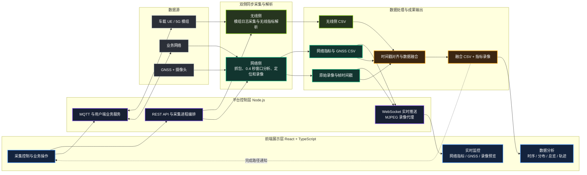
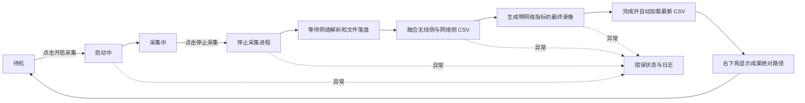

# 车联网数据采集与可视化平台技术路线

## 总体技术路线框图



## 一次完整采集的状态路线



## 关键技术点

| 环节 | 当前技术方案 | 主要输出 |
|---|---|---|
| 前端交互 | React、TypeScript、Vite、Recharts、高德地图 | 采集控制、实时展示、轨迹与统计分析 |
| 平台后端 | Node.js、Express、WebSocket、MQTT.js | REST 接口、采集进程编排、实时推送、数据查询 |
| 无线侧采集 | 32 位 Python、串口、QWinLog、厂商控制与解码 DLL | `dm_metrics.csv`、`at_metrics.csv`、`merged_metrics.csv` |
| 网络侧采集 | Python、Npcap、dumpcap、TCP 窗口分析 | PCAP、RTT、吞吐量、抖动、丢包率 |
| 定位采集 | NMEA 串口解析、经纬度坐标转换 | 与网络指标共用的 `window_metrics_gps.csv` |
| 视频采集 | OpenCV、MP4、逐帧真实时间戳、MJPEG | 原始录像、帧时间文件、浏览器实时预览 |
| 多源融合 | Python CSV 时间戳对齐 | 前端统一分析数据源 `session_*_full.csv` |
| 视频后处理 | 按视频帧时间匹配网络指标并叠加 | `camera_recording_metrics.mp4` |
| 停止控制 | 后端生成停止文件，采集进程监听并有序退出 | 统一停止、等待解析、融合和录像后处理 |

## 数据输出位置

```text
D:\ZQY\packet_collector\captures\session_*\
    ├─ window_metrics_gps.csv
    ├─ camera_recording.mp4
    ├─ camera_frame_timestamps.csv
    └─ camera_recording_metrics.mp4

D:\ZQY\radio_capture\BJTUCC-main\captures\session_*\
    ├─ dm_metrics.csv
    ├─ at_metrics.csv
    └─ merged_metrics.csv

D:\ZQY\iov-data-collector-(ue-stack)\datas\BJTU\
    └─ session_*_full.csv
```

> 当前实际的前端“开启采集”由 Node.js 后端直接隐藏启动两个 Python 进程。根目录的 `start_all_collectors.bat` 主要用于定位工作区和手动启动，不代表网页按钮的全部运行逻辑。
